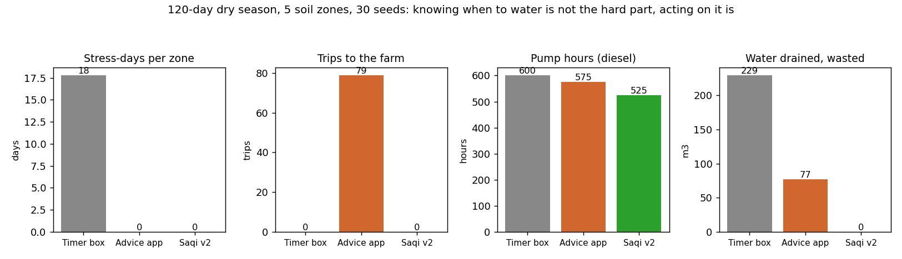
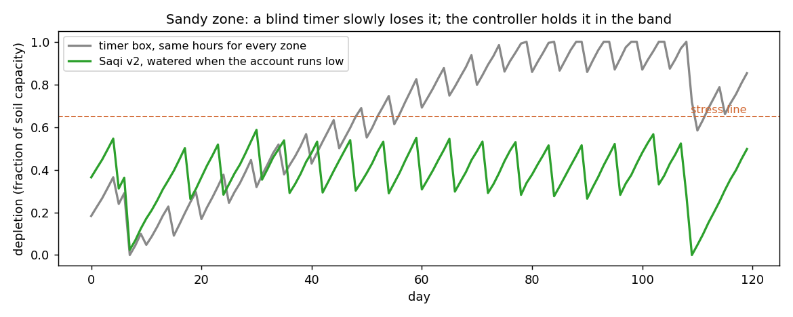
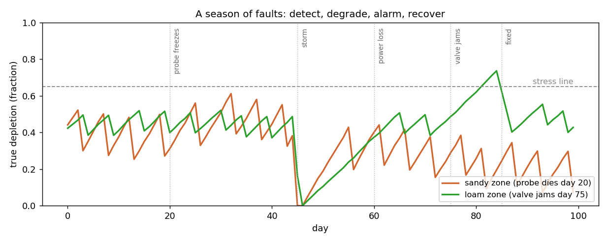
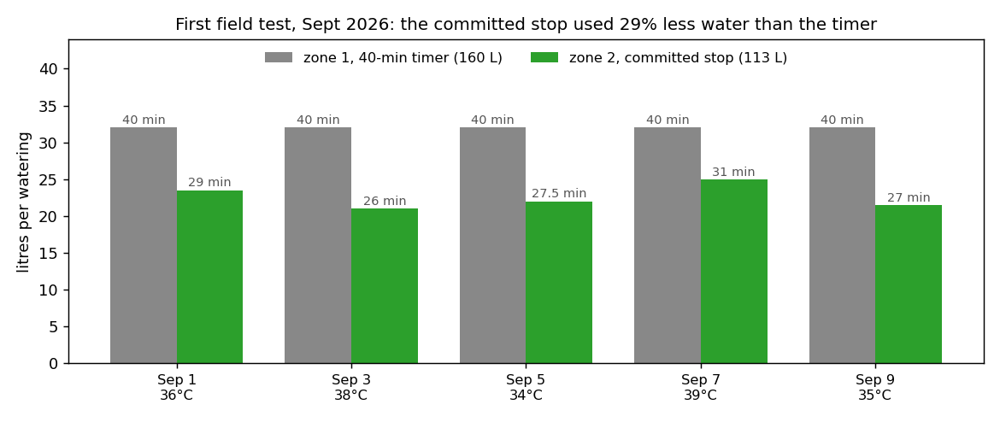

# Saqi v2

An offline irrigation controller for smallholder farms. One box at the water manifold keeps
a daily water account for each soil zone of the farm and runs the pump itself: it opens the
right zone valve when a zone's account runs low, stops exactly when the refill is committed,
and never needs internet, a server, or a person driving out to turn the water off.

## Why v2 exists

[Saqi v1](https://github.com/jjlalli/Saqi) argued, in simulation, that a farm can share scarce
water with a mesh of small devices, one per patch of the grove, and no central computer, and
that this survives network failures that break a cloud controller. That research stands.

Then I interviewed my father, a retired teacher who works our family's olive grove, and other
farmers nearby. Two things came out of those conversations.

First, per-tree sensing is redundant on a real smallholder farm. Trees in the same soil, on
the same slope, watered on the same line, sit at practically the same moisture. What actually
differs is the handful of soil zones the farm splits into. Commercial precision agriculture
reaches the same conclusion; it calls them management zones.

Second, information is not the bottleneck. Products already exist here (in Tunisia, Seabex
tells you from satellite data when and how much to irrigate) and most farmers around us
irrigate from their own well, so saving water is not what they care about. What costs them is
the pump's diesel and the trips: somebody still has to drive out, open the valve, wait, and
close it. Every existing tool stops at the phone notification. Nobody automates the stopping.

So v2 keeps v1's allocation brain and re-aims it: soil zones instead of patches of trees, one local controller
instead of a mesh, and the objective translated from litres into what a well irrigator feels,
pump hours and trips. The mesh idea from v1 does not die; it moves up a level, to several farms
sharing one well or canal with no central authority, which is future work.

## How it works

- The farm is split once into zones by soil type, using satellite imagery and the farmer's
  own knowledge. That map is static and lives on the device. No live satellite in the loop:
  satellite soil moisture reads the top few centimetres on a multi-day revisit, while olive
  roots drink from a metre down.
- Each zone has a water account: a running depletion estimate in mm, drained daily by
  evapotranspiration (computed FAO-56 style from a cheap local weather reading), topped up
  by rain and irrigation, and corrected by one soil probe per zone.
- When a zone's account crosses its refill line, the controller sequences the pump: driest
  zone first, within the pump's daily capacity, stopping each refill on committed water
  (what has been applied, not what a lagging sensor reads) so nothing drains past the roots.

## What is simulated and what the device does

The zoning and the water accounting are both in this repo, with one simplification each. The
zone map is a given input (the `ZONES` table at the top of `saqi2.py`, five zones with their
soil capacities); on a real farm that map is drawn once, from satellite imagery and the
farmer's knowledge, then lives on the device as exactly such a table. The ET accounting runs
every simulated day (crop coefficient times reference ET per zone), but the simulation draws
ET0 from typical dry-season values; the device computes it from its own weather reading.
In short: the repo proves the decision logic, the pilot proves the physics.

## What the simulation shows

A 120-day dry season on a 5-zone, 1.1-hectare farm, averaged over 30 random seasons, comparing
the three things a farmer can actually buy: a timer box (blind automation), an advice app
(perfect information, human execution), and Saqi v2 (informed automation).



The timer box gives every zone the same hours, so the two largest zones (sandy south and loam
center) get the shallowest watering and spend 42 to 47 of the 120 days in stress, about 18
stress-days per zone averaged over the farm, while the small clay zone gets the deepest watering
and drains the most. The advice app eliminates stress, but at the cost of 79 trips to the farm in one season,
and manual stopping still drains water past the roots. The controller matches the app's zero
stress with zero trips, the fewest pump hours, and nothing wasted.



Knowing when to water is not the hard part. Acting on it is.

## The controller brain, with things going wrong

`controller.py` is the reference implementation of the full loop the firmware ports:
water accounts, rain hold, weekly probe anchoring, and the fail-safes. It replays a
season where a probe freezes, a storm hits, the power dies mid-season, and a valve jams:



The box detects the dead probe (and keeps that zone alive on the model alone), closes
everything on reboot so a power cut can never leave a valve open, credits the storm
instead of watering through it, raises exactly one alarm for the jammed valve and parks
the zone until a human fixes it, then recovers. One subtlety worth reading in the code:
a frozen probe looks exactly like a broken valve, so the valve check refuses testimony
from a probe that has stopped moving.

## First field test (September 2026)

In the first ten days of September I ran a side-by-side test on two zones of my family's farm.
Zone 1 stayed on a fixed 40-minute timer. Zone 2 ran on a first prototype, assembled from an
off-the-shelf kit, that stops each watering on committed water. Both zones were watered every
other day, five times each. I recorded the litres and run time of every watering; the log is in
`data/pilot_2026-09.csv`.



| | Zone 1: 40-min timer | Zone 2: committed stop |
|---|---|---|
| Water, 5 waterings | 160 L | 113 L |
| Per watering | 32 L | 22.6 L (21 to 25) |
| Run time | 40 min | 26 to 31 min |

The prototype used 29% less water. Both zones share the same drip flow (0.8 L/min), so the whole
difference is how long the valve stayed open: 140.5 minutes in total against 200, 30% less, and
on a pumped line valve time is pump time. Its longest run was on the hottest day (39°C,
31 min), while the timer ran its 40 minutes regardless. I noticed water pooling around the tree
base in the timer zone on Sept 1 and Sept 9.

What this test doesn't show yet:

- No soil moisture was logged, only litres and minutes. It shows the prototype used less water,
  not yet that its zone stayed in the healthy band. The probe log comes next.
- Both zones were watered on the same days, so this tested when to stop, not when to start. The
  water-account trigger that decides when to water was not part of it.
- Drainage wasn't measured. The pooling notes are what I saw, not a number.
- The saving is relative to a 40-minute timer. A shorter timer would shrink it.
- Two zones in different spots, not swapped, over ten days. Next round: swap the zones, run a
  month, log the probes, and calibrate following `docs/BUILD.md`.

## Running it

```bash
pip install -r requirements.txt
python3 saqi2.py        # the strategy comparison -> saqi2_season.png, saqi2_timer_vs_auto.png
python3 controller.py   # the fault season -> saqi2_faults.png
python3 pilot.py        # the field test log -> saqi2_pilot.png
```

## Hardware target

One ESP32 controller at the manifold, a latching solenoid valve per zone, one capacitive soil
probe per zone, a temperature/humidity sensor, a rain gauge, a small solar panel and battery.
Parts for the two-zone pilot come to about $90 at the prices in `docs/DESIGN.md`; a five-zone
farm is roughly $150 (one valve and one probe per zone). The first field test (above) put a kit prototype on one zone against a
timer on the other. The full two-zone install, with the probe log running, is next: the design
is in `docs/DESIGN.md`, the wiring, calibration protocol, and acceptance checklist in
`docs/BUILD.md`.

## Limitations

The soil and weather model is deliberately simple, and the manual-watering baseline encodes
assumptions (visit behaviour, 15% overfill) that should be measured, not assumed. The constants
that matter (each zone's capacity, drying rate, and how fast applied water settles) have to be
calibrated on a real farm. The first field test only recorded litres and run time, so that
calibration is still ahead.

## AI use

I used AI assistants to help write and debug the code and to edit these docs. The design, the
interviews, and the field test are mine.

## License

MIT. See `LICENSE`.
